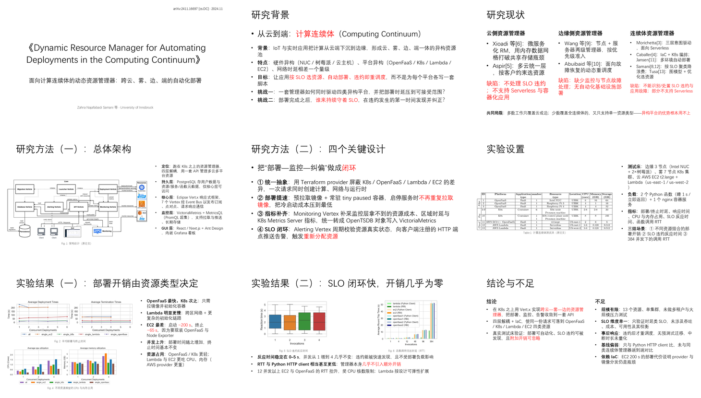

# 水组会 · shui-zuhui

> 一篇论文进去，一盏茶的工夫，一份看起来读了一个礼拜的组会汇报出来——白底、无装饰、红字点睛、原图直入，附逐页讲稿。



---

## 功能

**一句话：把论文 PDF 压成"只有干货"的汇报材料，而不是把论文抄一遍——省时间的是你，看到"认真"的是听众。**

- **固定叙事骨架，页数弹性** —— 研究背景 → 研究现状 → 研究方法 → 实验 → 结论与不足；页数以讲清为准，通常 8–12 页，按论文体量增减
- **零装饰版式** —— 纯白底、黑字、强调色克制（默认红 `#FF0000` 点睛，需要区分同类信息时可加蓝 `#0070C0`，全篇不超过两种强调色）；没有目录页、致谢页、页码、图标、色块、动画
- **原图直入** —— 从 PDF 按 400 dpi 无损裁出论文自己的图与表，不重绘、不带页眉
- **自动排版** —— 标题按字宽自动缩字号保证单行，正文按容器高度自动降字号，图注紧贴图片下沿
- **双产出** —— 一份 `.pptx`，一份逐页讲稿（每页 100–180 字口播 + 常见追问的答法）
- **内容与版式分离** —— 文案写在 `deck.json` 里，换论文只改文案，版式不会漂
- **七种版式** —— 封面 / 纯文字 / 多栏对照 / 单图+侧栏 / 双图叠放 / 双图并排 / 双栏结论
- **兜底能力强** —— 无文字层的 PDF（字体转曲线）也能处理：渲成图读，按坐标裁

---

## 产出

```
out.pptx      9 页左右的汇报稿
讲稿.md       逐页口播 + "如果被追问"的备答 + 时间分配建议
```

典型页面构成（以一篇典型论文为例，页数随内容伸缩）：

| 页   | 内容                          |
| --- | --------------------------- |
| 1   | 封面：英文原题、中文题眼、出处             |
| 2   | 研究背景：对象、三重异构、两个挑战           |
| 3   | 研究现状：三条技术路线，每条一句红字缺陷 → 共同局限 |
| 4–5 | 研究方法：总体架构（配架构图）+ 关键设计的动机    |
| 6   | 实验设置：测试床、负载、指标、场景（配表）       |
| 7–8 | 实验结果：数字 + 机理，配原论文曲线图        |
| 9   | 结论与不足：左 3 条结论，右 4–5 条不足     |

---

## 安装

### 一句话安装（发给你的 agent 即可）

把下面这句直接发给 agent（WorkBuddy / Claude Code 等），让模型自己完成安装：

```text
请安装 skill「shui-zuhui」：把仓库 https://github.com/plankton12138/shui-zuhui-ppt-skill 完整获取（git clone 或下载解压均可）到你的 skills 目录，然后在该目录执行 pip install -r requirements.txt，装好后读取 SKILL.md 并告诉我已就绪。
```

agent 会自行确认本机的 skills 目录位置、完成下载与依赖安装，并在读取 `SKILL.md` 后进入可用状态；之后说"帮我把这篇论文做成组会 PPT"即可触发。

### 1. 装进 agent 工具的 skills 目录

本 skill 是目录即安装：把整个 `shui-zuhui/` 文件夹放进目标 agent 工具的 skills 目录即可，agent 启动时会自动扫描并按 `SKILL.md` 的 description 匹配触发。

| agent 工具                | 用户级目录（所有会话可用）                       | 项目级目录（仅当前项目可用）                         |
| ----------------------- | ----------------------------------- | -------------------------------------- |
| WorkBuddy               | `~/.workbuddy/skills/shui-zuhui`    | `<项目>/.workbuddy/skills/shui-zuhui`    |
| WorkBuddy AI（CLI）       | `~/.workbuddy-ai/skills/shui-zuhui` | `<项目>/.workbuddy-ai/skills/shui-zuhui` |
| Claude Code             | `~/.claude/skills/shui-zuhui`       | `<项目>/.claude/skills/shui-zuhui`       |
| 其他兼容 Agent Skills 规范的工具 | 参见其文档中的 skills 目录约定                 | —                                      |

安装方式任选其一：

```bash
# 方式 A：git clone（便于后续 git pull 升级）
git clone https://github.com/plankton12138/shui-zuhui-ppt-skill ~/.workbuddy-ai/skills/shui-zuhui

# 方式 B：直接拷贝文件夹
cp -r /path/to/shui-zuhui ~/.workbuddy-ai/skills/shui-zuhui

# 方式 C：软链接（一份源码多处生效，改源码立即生效）
# Windows PowerShell（需管理员或开发者模式）：
New-Item -ItemType SymbolicLink -Path "$env:USERPROFILE\.workbuddy-ai\skills\shui-zuhui" -Target "C:\path\to\shui-zuhui"
# macOS / Linux：
ln -s /path/to/shui-zuhui ~/.workbuddy-ai/skills/shui-zuhui
```

多工具共用时不必拷多份——装一份到其中一个目录，其余目录用软链接（方式 C）指过去即可。

### 2. 装依赖

agent 运行本 skill 的脚本依赖 Python 3.9+：

```bash
pip install -r requirements.txt
```

`pymupdf`（读 PDF）、`python-pptx`（写 PPT）、`pillow`（量图片尺寸）、`pywin32`（Windows 下用 PowerPoint 导出预览图，可选）。

### 3. 验证

```bash
# 脚本可用
python scripts/extract_figures.py --help

# agent 能识别：在对话里说"帮我把这篇论文做成组会 PPT"，命中即安装成功
```

若未命中触发词，检查该目录下 `SKILL.md` 是否存在、frontmatter 的 `name`/`description` 是否完整，并重启 agent 会话。

---

## 快速开始

```bash
# 1. 看论文里有哪些图表
python scripts/extract_figures.py paper.pdf list

# 2. 裁图（按 caption 自动定位，400 dpi）
python scripts/extract_figures.py paper.pdf auto --caption "Fig. 2" --out figs/fig2.png

# 3. 写 deck.json（复制 examples 里那份改文案）

# 4. 生成
python scripts/build_deck.py deck.json -o out.pptx

# 5. 渲成图逐页检查
python scripts/render_deck.py out.pptx --outdir preview
```

遇到没有文字层的 PDF，`list` 会返回 `NO CAPTIONS FOUND`，改走渲染路线：

```bash
python scripts/extract_figures.py paper.pdf page --pages 1-12 --dpi 150 --outdir pages
```

---

## 原理

```
PDF ──► 抽取内容 ──► deck.json ──► 渲染器 ──► .pptx
                        │                        │
                        └──► 讲稿.md            └──► 逐页 PNG 校验
```

三层分离：

**内容层** `deck.json` —— 只写文案，用 `**加粗**`、`<r>红字</r>` 两个行内标记控制强调。

**版式层** `build_deck.py` —— 版式是常量，不是参数。所有页面走同一套网格（16:9、0.92 in 左边距、40pt 标题、24pt 正文、等线），渲染器负责：等比放图、按容器高度自动降字号、标题单行化、图注定位。

**校验层** `render_deck.py` —— 用 PowerPoint COM 导出逐页 PNG，让人眼确认没有溢出、没有压字、没有脏边。自动排版只能估算，最终验收靠看。

这样设计的好处：文案可以反复改而不影响版式；版式只在一个文件里改，不会出现"这页 40pt 那页 36pt"的漂移；出问题能定位到是哪一层。

---

## deck.json 速查

```json
{
  "title_en": "论文英文全名",
  "title_zh": "中文题眼",
  "venue": "arXiv:2411.16697 [cs.DC] · 2024.11",
  "slides": [
    { "type": "cover" },
    { "type": "points",  "title": "研究背景", "lead": "…<r>关键概念</r>", "bullets": ["**背景**：…"] },
    { "type": "columns", "title": "研究现状", "columns": [{"head":"云侧","lines":["…"],"tail":"缺陷：…"}], "footer": "**共同局限**：…" },
    { "type": "figure",  "title": "研究方法（一）：总体架构", "image": "figs/fig1.png", "caption": "Fig. 1  …", "bullets": ["…"] },
    { "type": "figure_stack", "images": [{"path":"…","caption":"…"}], "bullets": ["…"] },
    { "type": "figure_pair",  "images": [{"path":"…"},{"path":"…"}], "bullets": ["…"] },
    { "type": "two_col", "title": "结论与不足", "left": {"head":"结论","bullets":["…"]}, "right": {"head":"不足","bullets":["…"]} }
  ]
}
```

行内标记：`**加粗**`、`<r>红字</r>`、`<rb>红字加粗</rb>`、`<b>蓝字</b>`、`<bb>蓝字加粗</bb>`（蓝为可选第二强调色）。  
全部字段与版式常量见 [`references/style-spec.md`](references/style-spec.md)。

---

## 目录结构

```
shui-zuhui/
├── SKILL.md                      # 技能入口：版式契约 + 工作流 + 自查清单
├── README.md                     # 本文件
├── requirements.txt
├── references/
│   ├── style-spec.md             # 画布/字号/颜色/字体 + deck.json 全字段
│   ├── story-guide.md            # 9 页叙事骨架、红字规则、长度控制
│   └── narration-guide.md        # 口播稿写法、备用问答
├── scripts/
│   ├── extract_figures.py        # list / text / page / auto / crop / images
│   ├── build_deck.py             # deck.json → pptx
│   └── render_deck.py            # pptx → PNG（PowerPoint COM / LibreOffice）
└── examples/
    └── dynamic-resource-manager/ # 完整示例：deck.json、图、成品、讲稿
```

---

## 适用与不适用

**适合**：计算机方向的会议/期刊论文，有架构图或实验曲线，需要在组会、文献分享、开题汇报上讲 10–15 分钟。

**不适合**：纯理论论文（没有图可放）、综述（页数会超）、需要逐式推导的场合——它的目标是"讲清问题和思路"，不是"复现推导"。

---

## 已知限制

- **无文字层 PDF**：`list` / `text` 会全空，只能渲图肉眼读。不要指望 OCR——公式和图注 OCR 出来也是错的。
- **双栏跨栏图**：自动裁切可能只取到半栏，改用 `crop --relative` 手调。
- **模板页眉**：Springer 等模板每页有 running head，会跟着图一起被裁进来，需要按 pt 精确切边。裁完必须看一眼。
- **字号触底 14pt**：说明这页字太多，应当删字而不是继续缩——14pt 在投影上已不可读。
- **预览依赖 Office**：没有 PowerPoint 时退回 LibreOffice；两者都没有则无法完成视觉验收。

---

## 示例

`examples/dynamic-resource-manager/` 是一篇真实论文的完整产物（计算连续体资源管理器，arXiv 2411.16697）：

`deck.json` 文案 · `figs/` 六图一表 · `out.pptx` 成品 · `讲稿.md` 逐页口播 · `contact.png` 九页缩略图。

换论文时复制该目录，改 `deck.json` 与图，重跑两条命令即可。
